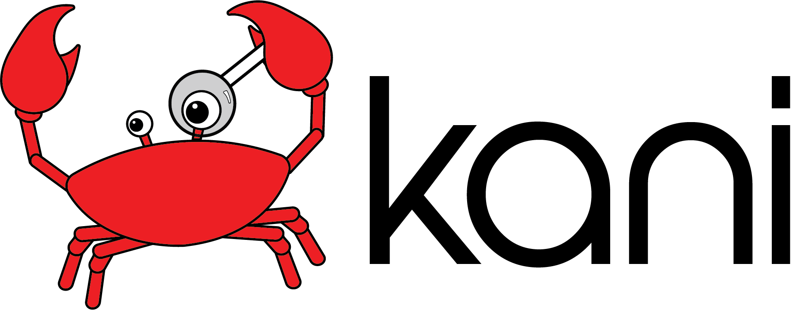

# Kani agent plugin

An agent plugin that lets coding agents (Kiro, Claude Code, GitHub Copilot, Cursor, Codex, ...)
formally verify Rust code with [Kani](https://github.com/model-checking/kani). Ask your agent to
prove a property, check `unsafe` code for undefined behavior, write or fix a proof harness,
explain a counterexample, or sweep a crate with AutoHarness. The plugin teaches the agent how
to do that well, including checking that a passing proof is not vacuous.

The plugin has three parts:

| Part | What it does | Required? |
|------|--------------|-----------|
| `skills/verify-rust/` | The verification workflow and Kani know-how the agent follows | yes |
| `scripts/` | Python helpers: compact result summaries, vacuity and assumption checks, version check | yes (Python 3 only) |
| `kani-mcp` ([`tools/kani-mcp`](../tools/kani-mcp)) | A small MCP server with structured Kani operations | no |

Everything works without the MCP server: the skill falls back to the Kani CLI, which exposes
every Kani feature.

## Requirements

- Kani, in the version range given by [`compatibility.json`](compatibility.json)
  (plugin 0.1.x: Kani >= 0.68.0, < 1.0.0). The plugin never installs or bundles Kani. To
  install it: `cargo install --locked kani-verifier && cargo kani setup`.
- Python 3.8 or newer, for the scripts.
- Optional: a Rust toolchain to build `kani-mcp`.

Check your setup with:

```bash
agent-plugin/scripts/check-kani-version.py
```

## Installation

Marketplace listings are not published yet. Until then, install from
this repository:

1. Point your agent's plugin/skill installation at the `agent-plugin/` directory of this
   repository (a sparse checkout of `agent-plugin/` is enough if you do not use the MCP server).
2. Optional, for the MCP tools: install the server so `kani-mcp` is on your `PATH`:

   ```bash
   cargo install --locked --git https://github.com/model-checking/kani kani-mcp
   ```

   `mcp.json` registers it as a local stdio server named `kani`.

## MCP tools

| Tool | Kani equivalent |
|------|-----------------|
| `kani_get_version` | `cargo kani --version`, checked against `compatibility.json` |
| `kani_list_harnesses` | `cargo kani list --format json` |
| `kani_verify_harness` | `cargo kani -Z export-json ...`, summarized |
| `kani_get_counterexample` | `cargo kani -Z concrete-playback --concrete-playback=print ...` |

Each tool takes a `path` (a Cargo project directory or a single `.rs` file) and `extra_args`
(passed to Kani unchanged). The verification tools also take `harness`, `exact`, `timeout_s`
(default 1800; Kani and its children are killed on timeout), `harness_timeout_s`, and
`export_path` / `log_path` to keep the results and console log; `kani_verify_harness` takes
`jobs` for parallel verification. Long runs send MCP progress notifications when the client
asks for them. `kani_list_harnesses` returns a summary unless `detail` is `full`.
`kani_get_version` also verifies a trivial harness, to check that CBMC and goto-cc work. The
server communicates only over stdio, never opens a network connection, and runs the Kani
installed on your machine.

## Scripts

All scripts print JSON and accept `--help`.

| Script | Purpose |
|--------|---------|
| `check-kani-version.py` | Is the installed Kani supported by this plugin release? |
| `summarize-results.py` | Compact summary of a `--export-json` file, including weakened checks and stubs the result relies on |
| `check-vacuity.py` | Unreachable assertions, unsatisfiable covers, missing vacuity probes |
| `check-specs.py` | Kani-backed checks: harness end reachable, preconditions satisfiable, precondition changes stronger or weaker |
| `check-proof-diff.py` | Changes since a baseline that weaken the agreed property, and any change to the code under verification |
| `check-witness.py` | Confirms a defect (the concrete playback witness fails) or a fix (fails before, passes after) |
| `evidence.py` | Records the run behind a reported result, and re-checks it later |
| `check-assumptions.py` | Quick text scan for contradictory, pinned, or over-strong `kani::assume` / `requires` |
| `inspect-harness.py` | Harness structure: inputs, assertions, attributes, missing unwind bounds |

## Compatibility and versioning

The plugin is versioned independently of Kani (`plugin.json` `version`). Each plugin release
lists the Kani versions it supports in `compatibility.json`; the version check script and
`kani_get_version` enforce it. When the skill, scripts, or MCP server start relying on a newer
Kani feature, raise `min_kani` in the same change.

## Privacy and support

- The plugin collects no telemetry and sends no data anywhere. All tools run locally.
- Report problems and request features at
  <https://github.com/model-checking/kani/issues> (mention "agent plugin" in the title).
- Security issues: do not open a public issue; follow [`.github/SECURITY.md`](../.github/SECURITY.md).

## Development

```bash
python3 agent-plugin/tests/validate_plugin.py   # manifests and skill structure
python3 agent-plugin/tests/test_scripts.py      # script unit tests, no Kani needed
cargo test -p kani-mcp                          # MCP server unit tests
cargo run -p compiletest -- --suite agent-plugin --mode exec   # end-to-end, needs a Kani build
```

The end-to-end smoke tests in [`tests/agent-plugin`](../tests/agent-plugin) run the skill's
workflow against the fixture crate in `tests/fixtures/crate`, both through the CLI only and
through `kani-mcp`. They are part of `scripts/kani-regression.sh`.

Keep one source of truth: marketplace-specific manifests must be thin wrappers around this
directory, never forks of the skill, scripts, or MCP server.
